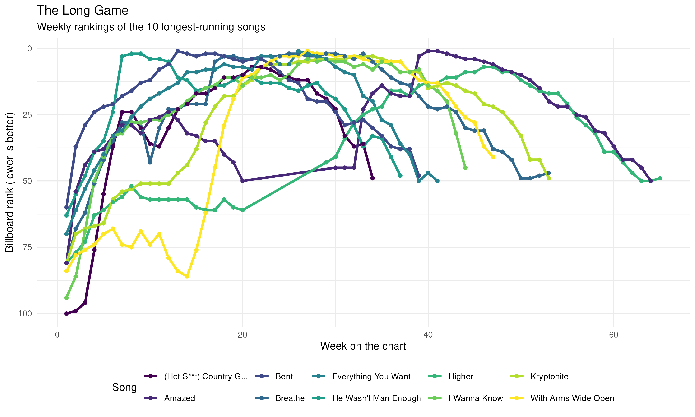

```{r}
#| message: false
library(tidyverse)
```

```{r}
billboard_long <- tidyr::billboard |>
  pivot_longer(
    cols = starts_with("wk"),
    names_to = "week",
    names_prefix = "wk",
    values_to = "rank",
    values_drop_na = TRUE
  ) |>
  mutate(week = as.integer(week))

longest_runs <- billboard_long |>
  count(artist, track, name = "weeks_on_chart") |>
  slice_max(weeks_on_chart, n = 10, with_ties = FALSE)

billboard_plot <- billboard_long |>
  semi_join(longest_runs, by = c("artist", "track")) |>
  ggplot(aes(x = week, y = rank, color = track, group = track)) +
  geom_line(linewidth = 1.2) +
  geom_point(size = 1.5) +
  scale_y_reverse() +
  scale_color_viridis_d() +
  labs(
    title = "The Long Game",
    subtitle = "Weekly rankings of the 10 longest-running songs",
    x = "Week on the chart",
    y = "Billboard rank (lower is better)",
    color = "Song"
  ) +
  theme_minimal() +
  theme(legend.position = "bottom")

ggsave("billboard-plot.png", plot = billboard_plot, width = 10, height = 6, dpi = 300)
```


